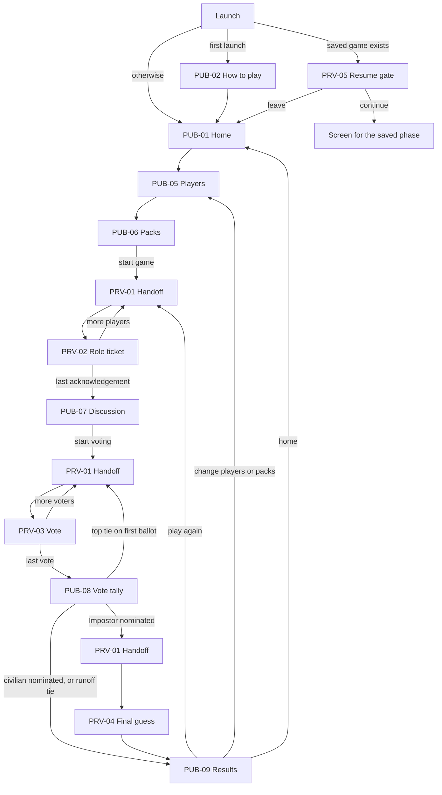

# Impostor TN — UX flows

Status: **DRAFT for Product Owner review (Stage 3).** Written against PRD v0.3 and `docs/product/DECISIONS.md` (D-01 to D-09). Nothing here is approved until the Product Owner says so. Items marked **Q-nn** are open decisions listed in `DECISIONS.md`; the flow shows the recommended option, not a ruling.

Companion documents: `SCREEN_SPECIFICATIONS.md` (what each screen contains) and `UX_RESEARCH_AND_RISKS.md` (assumptions, risks, validation plan).

## 1. Screen inventory

Fourteen screens and two overlays cover the whole MVP. A "screen" is a distinct destination; everything else is a state of one of them. The earlier estimate of 47 counted states as screens.

| ID | Screen | Theme | Purpose |
|---|---|---|---|
| PUB-01 | Home | paper | Start a game, open help or settings |
| PUB-02 | How to play | paper | Tutorial and help (also the first-launch onboarding) |
| PUB-03 | Settings | paper | Haptics, credits, version |
| PUB-04 | Licences | paper | Full licence texts |
| PUB-05 | Players | paper | Enter 4–12 names and their order |
| PUB-06 | Packs | paper | Choose word packs and start the game |
| PUB-07 | Discussion | paper | Clue rules; move on to voting |
| PUB-08 | Vote tally | paper | Outcome of a ballot: nominee, runoff or draw |
| PUB-09 | Results | paper | Winner, secret word, Impostor, votes, final guess; replay |
| PRV-01 | Handoff | carbon | Neutral "pass the phone to {name}" |
| PRV-02 | Role ticket | carbon | Sealed → revealed → acknowledged |
| PRV-03 | Vote | carbon | One player's private vote |
| PRV-04 | Final guess | carbon | The Impostor's single guess |
| PRV-05 | Resume gate | carbon | Neutral entry after the app was closed mid-game |
| OVL-01 | Edit player sheet | paper | Add, rename, reorder, delete a player |
| OVL-02 | Leave-game dialog | either | Confirm abandoning the current game |

Private (carbon) screens are the ones a single player is meant to see alone. They all sit inside one private wrapper that applies the carbon theme and the privacy protections (ADR-0006).

## 2. Overview

## 3. Persisted checkpoints

The app advances only after the listed data is saved in one transaction (PRD §11, ADR-0003). While a checkpoint is saving, the triggering button shows its loading state; if saving fails, the app stays where it is and shows a retryable error.

| # | Checkpoint | Trigger | Saved |
|---|---|---|---|
| C0 | Roster and packs | Any edit in PUB-05 / PUB-06 | Player names, order, selected packs (retained for replay, PRD §4) |
| C1 | Start game | Primary button on PUB-06; "play again" on PUB-09 | New session: player snapshot, selected packs, Impostor, secret word reference, phase = reveal |
| C2 | Consume word | First "I am {name}" tap of the game on PRV-01 | Word ID added to the cooldown, once (**Q-16**) |
| C3 | Acknowledge | "Got it, hide" on PRV-02 | That player's acknowledgement; after the last one, phase = discussion |
| C4 | Open voting | Primary button on PUB-07 | Phase = first ballot |
| C5 | Submit vote | Confirm on PRV-03 (first ballot) | The vote; after the last one, the outcome: phase = runoff, final guess or result |
| C6 | Submit runoff vote | Confirm on PRV-03 (runoff) | The vote; after the last one, the outcome: phase = final guess or result |
| C7 | Submit final guess | Final confirmation on PRV-04 | Normalized guess, correct/incorrect, phase = result |
| C8 | End session | Play again, change setup, home, leave game | Session deleted; roster, packs, cooldown and settings kept |

Why C2 is separate from C1: PRD §10 requires the word to be recorded "before the first private role reveal is prepared" and also that "a game abandoned before the first reveal must not consume a word". A group that starts a game and leaves from the very first handoff has not prepared a reveal, so nothing may be consumed yet. Recording on the first "I am {name}" satisfies both sentences. This is an interpretation and is listed as Q-16.

## 4. Flows

### F1 — Launch

1. First launch ever (no "tutorial seen" flag): open PUB-02 in its first-launch state. Leaving it, by its button or by system back, sets the flag and opens PUB-01. (**Q-21**)
2. A saved game exists and is valid:
   - phase = result → open PUB-09 directly (the game is over; nothing is secret any more);
   - any other phase → open PRV-05.
3. A saved game exists but is corrupt or incompatible: it is cancelled (PRD §11), and PUB-01 opens with an information banner saying the last game could not be restored. No detail about the lost game is shown.
4. Otherwise: PUB-01.

### F2 — Help and settings

- PUB-01 → PUB-02 → back to PUB-01. Help is reachable only from Home; there is no in-game help in the MVP.
- PUB-01 → PUB-03 → PUB-04 → back.
- Settings holds: haptics switch; credits (both fonts and Lucide, as the handoff requires); app version. No sound switch until sound assets exist (D-05, Q-09).

### F3 — Setup

1. PUB-01 "new game" → PUB-05. A retained roster is pre-filled.
2. PUB-05: add, rename, reorder and delete players through OVL-01. The continue button is enabled only with 4–12 valid, unique names.
3. PUB-05 → PUB-06: choose one or more packs. Only packs with approved, available words can be selected (PRD §10). Retained selections are pre-ticked if still available.
4. PUB-06 "let's start" → C1.
   - Success → paper-to-carbon transition → PRV-01 for player 1.
   - No eligible approved word (after cooldown release, PRD §10) → error banner on PUB-06; nothing is created.
   - Save failure → error banner; retry.

Validation (PRD §4): fewer than 4 or more than 12 players, an empty name, a duplicate name, or no available pack each block progress with a visible reason next to the problem. Name length and duplicate rules are Q-01.

### F4 — Role reveal (PRD §5)

For each player in order:

1. **PRV-01 Handoff.** Shows only the player's name and position. Button "I am {name}".
   - First handoff of the game only: the tap performs C2 before continuing.
2. **PRV-02, sealed.** The ticket shows the player's name and a lock. Two controls: "show me my role" and "back" (returns to PRV-01, for the case where the wrong person took the phone).
3. **PRV-02, revealed.** Civilian: role, secret word, category. Impostor: role, category only, and a note that they do not know the word. Same layout, colours, sizes, sound and haptic for both. There is no timer. "Got it, hide" appears under the ticket and is disabled for the first 800 ms.
4. **Acknowledge.** The secret leaves the screen in the same frame as the tap. C3 runs while the ticket is already sealed again and the button shows its loading state.
   - Saved, more players → PRV-01 for the next player.
   - Saved, last player → carbon-to-paper transition → PUB-07.
   - Save failure → error banner on the sealed ticket with "retry". Retrying repeats C3 only; it does not show the role again unless the player taps "show me my role".

Interruptions are covered in F9.

### F5 — Discussion (PRD §6)

1. PUB-07 confirms everyone has seen their role, tells the group to put the phone in the middle, and states the clue rules: one spoken word each, passing is allowed.
2. The app records nothing and tracks no turns (D-03).
3. "Start voting" → C4 → paper-to-carbon transition → PRV-01 for voter 1.

A player who forgets their word cannot look again in the MVP: PRD §5 and §12 require private information to be hidden after acknowledgement and define no way back. See Q-20.

### F6 — First ballot (PRD §7)

For each player in order:

1. **PRV-01 Handoff** (identical to the reveal handoff).
2. **PRV-03 Vote.** Lists every player. The voter's own row is visibly unavailable and marked "you". Selecting a row enables "confirm". "Back" returns to PRV-01 and discards the selection.
3. "Confirm" → C5. There is no way to view or change a submitted vote (D-02), and no way to skip: the only exits are confirm, back to the handoff, or leaving the game.
   - Saved, more voters → PRV-01 for the next voter.
   - Saved, last voter → carbon-to-paper transition → PUB-08.

**PUB-08 after the first ballot** shows the count for every player.

| Outcome | What PUB-08 shows | Next |
|---|---|---|
| One player has the unique highest count and is a civilian | Tally with that player emphasised | "See the result" → PUB-09 (Impostor wins) |
| One player has the unique highest count and is the Impostor | Tally, then the statement that this player is the Impostor and gets one guess | "Pass the phone" → F8 |
| Two or more players share the highest count | Tally with the tied players emphasised and the tie banner | "Vote again" → F7 |

Ties below the top are irrelevant. Nothing is decided randomly or by player order.

### F7 — Runoff (PRD §7)

Exactly one runoff, with fresh votes. All players vote, in the same order.

1. PRV-01 Handoff, then PRV-03 in its runoff state: only the tied players are listed. If the voter is one of them, their own row is unavailable. A voter who was not tied may choose any listed player.
2. "Confirm" → C6. After the last vote → PUB-08.

**PUB-08 after the runoff** shows the runoff counts for the tied players.

| Outcome | Next |
|---|---|
| Unique winner, a civilian | "See the result" → PUB-09 (Impostor wins) |
| Unique winner, the Impostor | "Pass the phone" → F8 |
| Still tied | "See the result" → PUB-09 (draw, no final guess) |

With two tied candidates each of them can only vote for the other; the remaining players decide. With every player tied, everyone is a candidate and nobody can vote for themselves. Both cases work without special handling.

### F8 — Final guess (PRD §8)

1. PUB-08 has just told the table that the nominee is the Impostor. This public statement is unavoidable: the PRD gives the guess only to a nominated Impostor, so handing them the phone reveals it. The secret word stays hidden.
2. PRV-01 Handoff for the Impostor.
3. **PRV-04, entry.** One text field. "Confirm" is disabled while the field is empty or only spaces.
4. **PRV-04, review.** The typed guess is shown large with "yes, this is my answer" and "change it". This guards a one-shot, irreversible input against typos (**Q-22**).
5. Final confirmation → C7 → carbon-to-paper transition → PUB-09.

Matching (D-01): trim, collapse repeated spaces, then exact comparison with the canonical word and its aliases. Nothing else is normalized. The app gives no hint, no character count of the answer and no "close" feedback.

### F9 — Results and replay (PRD §8, §9)

PUB-09 reveals, in this order: the winner, the secret word and category, the final guess and whether it was correct (when there was one), every player's role, and the vote counts for each ballot.

| Situation | Winner |
|---|---|
| Civilian nominated | Impostor |
| Impostor nominated, guess correct | Impostor |
| Impostor nominated, guess wrong | Civilians |
| Runoff tied | Draw |

Actions:

- **Play again** → C8 then C1 with the same players, order and packs → PRV-01. If no eligible word exists, the error appears on PUB-09 and the finished result stays visible.
- **Change players or packs** → C8 → PUB-05.
- **Home** → C8 → PUB-01.

No scores are kept (PRD §9).

### F10 — Leaving a game

- Public in-game screens (PUB-07, PUB-08) have a close button that opens OVL-02. On PUB-09 the game is already over, so "home" needs no confirmation.
- On every in-game screen, system back opens OVL-02 instead of navigating, with two exceptions: on PRV-02 sealed and PRV-03 it behaves like the "back" button (return to the handoff), and on PRV-02 revealed and while a checkpoint is saving it does nothing.
- Private screens show no visible leave control, because the handoff specification allows nothing but the name, the position and one button. Leaving from them relies on system back and on PRV-05. (**Q-19**)
- Confirming OVL-02 → C8 → PUB-01. If the word was already consumed (C2), it stays in the cooldown.

### F11 — Interruption and recovery (PRD §5, §11, §12)

**Warm return** (app sent to the background and brought back, process alive). When the app leaves the foreground on a private screen, the secret is removed immediately.

| Was on | Returns to |
|---|---|
| PRV-01 | PRV-01, same player |
| PRV-02 sealed or revealed, not yet acknowledged | PRV-01, same player; they must tap and reveal again |
| PRV-02 while C3 was saving | PRV-01 for whoever is next according to saved state |
| PRV-03, vote not submitted | PRV-01, same voter; the selection is discarded |
| PRV-04, guess not submitted | PRV-01 for the Impostor; typed text is discarded |
| Any public screen | The same screen |

**Cold start** (process was killed). PRV-05 opens first, then "continue" leads to:

| Saved phase | Opens |
|---|---|
| Reveal | PRV-01 for the first player without a saved acknowledgement |
| Discussion | PUB-07 |
| First ballot, some votes missing | PRV-01 for the first player without a saved vote |
| Runoff, no runoff vote yet | PUB-08 (first-ballot tie), so the group sees why they are voting again |
| Runoff, some votes saved | PRV-01 for the first player without a saved runoff vote |
| Final guess pending | PUB-08 (nominee is the Impostor), then the handoff |
| Result | PUB-09 directly, without PRV-05 |

Guarantees: roles and the word are never reassigned; a saved acknowledgement or vote is never asked for twice; an unsaved one is simply asked for again; the word is consumed at most once; no secret is on screen when the app returns.

**Unrecoverable state**: see F1 step 3.

## 5. Navigation rules

- Outside a game, the app bar back button and system back go to the previous screen.
- Inside a game there is no backwards navigation between phases. The current screen is always derived from saved state.
- Paper ↔ carbon changes use the `carbonIn` / `carbonOut` transitions; between two carbon screens only the content changes.
- Android state restoration is not used for game screens; recovery comes from saved state only.

## 6. PRD traceability

| PRD | Requirement | Where |
|---|---|---|
| §3 P0 | Home and game setup | PUB-01, PUB-05, PUB-06, F3 |
| §4 | 4–12 players, order, pack selection, validation, retention | PUB-05, OVL-01, PUB-06, C0 |
| §5 | Exactly one Impostor; stable assignment | C1, F11 |
| §5 | Deliberate reveal, separate acknowledgement, no timer, same structure for both roles | PRV-02, F4 |
| §5 | Acknowledgement persisted before advancing; neutral handoff between players | C3, PRV-01 |
| §5 | Interrupted reveal can be repeated; committed acknowledgement resumes at the next player | F11 |
| §6 | One-word spoken clues, passing allowed, obvious transition to voting | PUB-07, F5 |
| §7 | Everyone votes once, privately, not for themselves; no skip, duplicate or change | PRV-03, C5, F6 |
| §7 | Unique top → nominated; top tie → exactly one runoff; no random tie-break | PUB-08, F6 |
| §7 | Runoff: all vote, only tied candidates, fresh ballot; tie → draw | PRV-03 runoff state, C6, F7 |
| §8 | Private, single, textual final guess; exact matching | PRV-04, C7, F8 |
| §8 | Win conditions; result reveals word, Impostor, votes, winner, guess outcome | PUB-09, F9 |
| §9 | Replay without re-entry, new session, no scores | F9, C8 → C1 |
| §10 | Only approved, available content selectable | PUB-06 |
| §10 | Cooldown recorded once, before the first reveal; not when abandoned earlier; controlled error when nothing is eligible | C2, F3 step 4, Q-16 |
| §11 | Persist and recover every phase; cancel safely when corrupt | §3, F11, F1 |
| §12 | Neutral handoffs, hide after acknowledgement, private votes, neutral resume, screenshot protection | PRV-01 to PRV-05, F11, ADR-0006 |
| §13 | RTL, Derja, mixed digits, Tesskra | `SCREEN_SPECIFICATIONS.md` §1 |
| §14 | Tutorial covering six topics; basic settings | PUB-02, PUB-03 |

Requirements that the flows cannot satisfy by themselves are listed in `UX_RESEARCH_AND_RISKS.md` §5.
