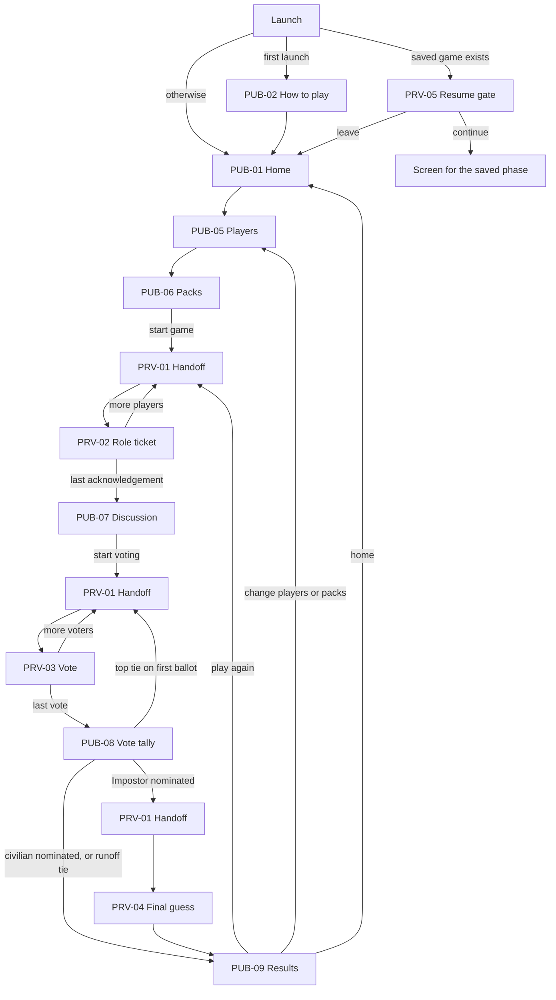

# Impostor TN — UX flows

Status: **DRAFT for Product Owner review (Stage 3).** Written against PRD v0.3 and `docs/product/DECISIONS.md` (D-01 to D-09). Nothing here is approved until the Product Owner says so. Items marked **Q-nn** are open decisions listed in `DECISIONS.md`; the flow shows the recommended option, not a ruling.

Companion documents: `SCREEN_SPECIFICATIONS.md` (what each screen contains) and `UX_RESEARCH_AND_RISKS.md` (assumptions, risks, validation plan).

Revision 2 (2026-11-16, consistency audit): §3 now defines retry safety, restore checks, the final-guess text forms and word selection; replay is one atomic step (C9); F10 and F11 are complete tables. Summary of changes: `UX_RESEARCH_AND_RISKS.md` §7.

## 1. Screen inventory

Fourteen screens and two overlays cover the whole MVP. A "screen" is a distinct destination; everything else is a state of one of them. The earlier estimate of 47 counted states as screens.

| ID | Screen | Theme | Purpose |
|---|---|---|---|
| PUB-01 | Home | paper | Start a game, open help or settings |
| PUB-02 | How to play | paper | Tutorial and help (also the first-launch onboarding) |
| PUB-03 | Settings | paper | Haptics, credits, version |
| PUB-04 | Licences | paper | Full licence texts |
| PUB-05 | Players | paper | Enter 3–12 names and their order |
| PUB-06 | Packs | paper | Choose word packs and start the game |
| PUB-07 | Discussion | paper | Clue rules; move on to voting |
| PUB-08 | Vote tally | paper | Outcome of a ballot: nominee, runoff or draw |
| PUB-09 | Results | paper | Winner, secret word, Impostor, votes, final guess; replay |
| PRV-01 | Handoff | carbon | Neutral "pass the phone to {name}" |
| PRV-02 | Role ticket | carbon | Sealed → revealed → acknowledged |
| PRV-03 | Vote | carbon | One player's private vote |
| PRV-04 | Final guess | carbon | The Impostor's single guess |
| PRV-05 | Resume gate | carbon | Neutral entry after the app was closed mid-game |
| OVL-01 | Edit player sheet | paper | Add, rename, reorder, delete a player |
| OVL-02 | Leave-game dialog | either | Confirm abandoning the current game |

Private (carbon) screens are the ones a single player is meant to see alone. They all sit inside one private wrapper that applies the carbon theme and the privacy protections (ADR-0006).

## 2. Overview

## 3. Persisted checkpoints

The app advances only after the listed data is saved in one transaction (PRD §11, ADR-0003). While a checkpoint is saving, the triggering button shows its loading state; if saving fails, the app stays where it is and shows a retryable error.

| # | Checkpoint | Trigger | Saved |
|---|---|---|---|
| C0 | Roster and packs | Any edit in PUB-05 / PUB-06 | Player names, order, selected packs (retained for replay, PRD §4) |
| C1 | Start game | Primary button on PUB-06 | New session: player snapshot, selected packs, Impostor, secret word reference, phase = reveal, word not yet consumed |
| C2 | Consume word | An "I am {name}" tap on PRV-01 during the reveal phase while the session's word is not marked consumed (normally the first tap of the game) | The word moved to the newest position of the cooldown and the session marked "word consumed", together (**Q-16**) |
| C3 | Acknowledge | "Got it, hide" on PRV-02 | That player's acknowledgement; after the last one, phase = discussion |
| C4 | Open voting | Primary button on PUB-07 | Phase = first ballot |
| C5 | Submit vote | Confirm on PRV-03 (first ballot) | The vote; after the last one, the outcome: phase = runoff, final guess or result |
| C6 | Submit runoff vote | Confirm on PRV-03 (runoff) | The vote; after the last one, the outcome: phase = final guess or result |
| C7 | Submit final guess | Final confirmation on PRV-04 | The guess exactly as typed, correct/incorrect, phase = result (§3.3) |
| C8 | End session | Change setup, home, leave game | Session deleted; roster, packs, cooldown and settings kept |
| C9 | Replace session | "Play again" on PUB-09 | In one transaction: the finished session deleted and a new one created as in C1. If no word can be chosen or the save fails, nothing changes and the finished result is still there |

### 3.1 Retrying and duplicates

A save can fail, be retried, or be interrupted by the process dying. Three rules make every checkpoint safe to repeat:

1. Before writing, the app re-reads the saved state. If the thing it is about to save is already there, it writes nothing and continues as if the save had just succeeded.
2. The store itself refuses duplicates (one acknowledgement per player, one vote per voter per ballot, one guess per session, one cooldown entry per word), so a programming slip cannot double-count either.
3. Everything a checkpoint saves is written in one transaction: either all of it is there afterwards or none of it.

| Checkpoint | Process dies before the save completes | Process dies after it completes | Retry after an error |
|---|---|---|---|
| C1 | No session exists; the group is back at Home with the roster kept | Session exists; resume gate, then the first handoff | A second start cannot happen: the first successful one left the packs screen |
| C2 | Word not consumed; the next "I am {name}" in the reveal phase runs C2 again | Word consumed and marked; C2 never runs again for this session | Same tap again; the "consumed" mark prevents a second entry |
| C3 | That player has no acknowledgement and reveals again (PRD §5 allows this) | Flow resumes at the next player without an acknowledgement | Retry saves the same player's acknowledgement once; the role is not shown again |
| C4 | Phase is still discussion | Phase is first ballot; the first handoff | Harmless to repeat |
| C5, C6 | That voter has no vote in the ballot and votes again | Flow resumes at the next voter without a vote, or at the tally if it was the last | If a vote by this voter already exists in this ballot, it stands; nothing is written |
| C7 | No guess saved; the Impostor gets the handoff and types again | Result | If a guess is already saved, it stands; nothing is written |
| C8, C9 | The old session still exists and is resumed or shown | Old session gone (and, for C9, the new one exists) | Harmless to repeat |

The last acknowledgement and the change to the discussion phase are one save; so are the last vote of a ballot and its outcome. There is never a moment in which all votes are saved but the outcome is not.

### 3.2 What a restore checks, and what it never does

A saved session is accepted only if all of this holds; otherwise it is cancelled (F1 step 3):

- 4 to 12 players; exactly one of them is the Impostor; the word reference exists in the bundled content.
- Acknowledgements belong to players of the session and form an unbroken run from the first player in order. A gap means the data is damaged; the app does not guess.
- Votes belong to the current session; no voter appears twice in a ballot; nobody voted for themselves; runoff votes name only tied players.
- The phase agrees with the data (for example "discussion" requires every acknowledgement).

A restore never draws a new Impostor or word, never fills in a missing acknowledgement or vote, and never moves past a player who has not acknowledged: the next player is always the first one in order without a saved acknowledgement (or vote).

### 3.3 The final guess: what is stored, compared and shown

| Form | Definition | Used for |
|---|---|---|
| Raw | The text exactly as it is in the field at the final confirmation, character for character | Stored (C7). Nothing else about the guess is stored except the outcome |
| Display | Raw with leading and trailing spaces removed. Nothing else changed | Shown in the review state of PRV-04 and on PUB-09, so the table sees exactly what the Impostor confirmed |
| Comparison | Raw with leading and trailing spaces removed and each run of spaces inside reduced to one (D-01). Nothing else: no change to letters, diacritics, tatweel or letter case | Compared, character for character, with the comparison form of the canonical word and of each alias. Equal to any of them → correct |

Three details of "nothing else" are not settled by D-01 and are listed in Q-26: which characters count as spaces, whether invisible formatting characters are removed, and whether both sides are brought to the same Unicode composition form. Until decided, the strict reading applies (only the ordinary space counts; nothing is removed).

### 3.4 Word selection and the cooldown (PRD §10)

- Candidates: the approved, published words of the selected packs.
- Eligible: candidates that are not among the 30 most recently used words.
- If at least one word is eligible, one is drawn from the eligible words.
- If none is eligible, the cooldown is released from its oldest entry forward, one entry at a time, until an entry is a candidate; that word is used. In effect the least recently used candidate comes back. This takes at most 30 steps and involves no chance.
- Releasing does not delete anything from the cooldown; it only decides this one selection. (An engineering detail that needs confirming with ADR-0003.)
- The word is written to the cooldown at C2, as its newest entry. If it was already in the list (the release case), it moves to the newest position instead of appearing twice.
- If the selected packs contain no approved word at all, starting fails with a clear message (PUB-06). This cannot be caused by the cooldown.

The player sees none of this. Pack cards show the total of approved words, never the eligible number (Q-27).

### 3.5 Why C2 is separate from C1

PRD §10 requires the word to be recorded "before the first private role reveal is prepared" and also that "a game abandoned before the first reveal must not consume a word". A group that starts a game and leaves from the very first handoff has not prepared a reveal, so nothing may be consumed yet. Recording on the first "I am {name}" satisfies both sentences. This is an interpretation and is listed as Q-16.

## 4. Flows

### F1 — Launch

1. First launch ever (no "tutorial seen" flag): open PUB-02 in its first-launch state. Leaving it, by its button or by system back, sets the flag and opens PUB-01. (**Q-21**)
2. A saved game exists and is valid:
   - phase = result → open PUB-09 directly (the game is over; nothing is secret any more);
   - any other phase → open PRV-05.
3. A saved game exists but is corrupt or incompatible: it is cancelled (PRD §11), and PUB-01 opens with an information banner saying the last game could not be restored. No detail about the lost game is shown.
4. Otherwise: PUB-01.

### F2 — Help and settings

- PUB-01 → PUB-02 → back to PUB-01. Help is reachable only from Home; there is no in-game help in the MVP.
- PUB-01 → PUB-03 → PUB-04 → back.
- Settings holds: haptics switch; credits (both fonts and Lucide, as the handoff requires); app version. No sound switch until sound assets exist (D-05, Q-09).

### F3 — Setup

1. PUB-01 "new game" → PUB-05. A retained roster is pre-filled.
2. PUB-05: add, rename, reorder and delete players through OVL-01. The continue button is enabled only with 3–12 valid, unique names (D-41).
3. PUB-05 → PUB-06: choose one or more packs. Only packs with approved, available words can be selected (PRD §10). Retained selections are pre-ticked if still available.
4. PUB-06 "let's start" → C1.
   - Success → paper-to-carbon transition → PRV-01 for player 1.
   - The selection contains no approved word (§3.4; the cooldown alone can never cause this) → error banner on PUB-06; nothing is created.
   - Save failure → error banner; retry.

Validation (PRD §4): fewer than 4 or more than 12 players, an empty name, a duplicate name, or no available pack each block progress with a visible reason next to the problem. Name length and duplicate rules are Q-01.

### F4 — Role reveal (PRD §5)

For each player in order:

1. **PRV-01 Handoff.** Shows only the player's name and position. Button "I am {name}".
   - First handoff of the game only: the tap performs C2 before continuing.
2. **PRV-02, sealed.** The ticket shows the player's name and a lock. Two controls: "show me my role" and "back" (returns to PRV-01, for the case where the wrong person took the phone).
3. **PRV-02, revealed.** Civilian: role, secret word, category. Impostor: role, category only, and a note that they do not know the word. Same layout, colours, sizes, sound and haptic for both. There is no timer. "Got it, hide" appears under the ticket and is disabled for the first 800 ms.
4. **Acknowledge.** The secret leaves the screen in the same frame as the tap. C3 runs while the ticket is already sealed again and the button shows its loading state.
   - Saved, more players → PRV-01 for the next player.
   - Saved, last player → carbon-to-paper transition → PUB-07.
   - Save failure → error banner on the sealed ticket with "retry". Retrying repeats C3 only and never shows the role again. If saving keeps failing, system back offers to leave the game.

Interruptions are covered in F9.

### F5 — Discussion (PRD §6)

1. PUB-07 confirms everyone has seen their role, tells the group to put the phone in the middle, and states the clue rules: one spoken word each, passing is allowed.
2. The app records nothing and tracks no turns (D-03).
3. "Start voting" → C4 → paper-to-carbon transition → PRV-01 for voter 1.

A player who forgets their word cannot look again in the MVP: PRD §5 and §12 require private information to be hidden after acknowledgement and define no way back. See Q-20.

### F6 — First ballot (PRD §7)

For each player in order:

1. **PRV-01 Handoff** (identical to the reveal handoff).
2. **PRV-03 Vote.** Lists every player. The voter's own row is visibly unavailable and marked "you". Selecting a row enables "confirm". "Back" returns to PRV-01 and discards the selection.
3. "Confirm" → C5. There is no way to view or change a submitted vote (D-02), and no way to skip: the only exits are confirm, back to the handoff, or leaving the game.
   - Saved, more voters → PRV-01 for the next voter.
   - Saved, last voter → carbon-to-paper transition → PUB-08.

**PUB-08 after the first ballot** shows the count for every player.

| Outcome | What PUB-08 shows | Next |
|---|---|---|
| One player has the unique highest count and is a civilian | Tally with that player emphasised | "See the result" → PUB-09 (Impostor wins) |
| One player has the unique highest count and is the Impostor | Tally, then the statement that this player is the Impostor and gets one guess | "Pass the phone" → F8 |
| Two or more players share the highest count | Tally with the tied players emphasised and the tie banner | "Vote again" → F7 |

Ties below the top are irrelevant. Nothing is decided randomly or by player order.

### F7 — Runoff (PRD §7)

Exactly one runoff, with fresh votes. All players vote, in the same order.

1. PRV-01 Handoff, then PRV-03 in its runoff state: only the tied players are listed. If the voter is one of them, their own row is unavailable. A voter who was not tied may choose any listed player.
2. "Confirm" → C6. After the last vote → PUB-08.

**PUB-08 after the runoff** shows the runoff counts for the tied players.

| Outcome | Next |
|---|---|
| Unique winner, a civilian | "See the result" → PUB-09 (Impostor wins) |
| Unique winner, the Impostor | "Pass the phone" → F8 |
| Still tied | "See the result" → PUB-09 (draw, no final guess) |

With two tied candidates each of them can only vote for the other; the remaining players decide. With every player tied, everyone is a candidate and nobody can vote for themselves. Both cases work without special handling.

### F8 — Final guess (PRD §8)

1. PUB-08 has just told the table that the nominee is the Impostor. This public statement is unavoidable: the PRD gives the guess only to a nominated Impostor, so handing them the phone reveals it. The secret word stays hidden.
2. PRV-01 Handoff for the Impostor.
3. **PRV-04, entry.** One text field. "Confirm" is disabled while the field is empty or only spaces.
4. **PRV-04, review.** The guess is shown large, in its display form (§3.3), with "yes, this is my answer" and "change it". This guards a one-shot, irreversible input against typos (**Q-22**).
5. Final confirmation → C7 → carbon-to-paper transition → PUB-09.

Matching uses the comparison form defined in §3.3 (D-01). The app gives no hint, no character count of the answer and no "close" feedback.

### F9 — Results and replay (PRD §8, §9)

PUB-09 reveals, in this order: the winner, the secret word and category, the final guess and whether it was correct (when there was one), every player's role, and the vote counts for each ballot.

| Situation | Winner |
|---|---|
| Civilian nominated | Impostor |
| Impostor nominated, guess correct | Impostor |
| Impostor nominated, guess wrong | Civilians |
| Runoff tied | Draw |

Actions:

- **Play again** → C9 with the same players, order and packs → PRV-01. If it fails, the error appears on PUB-09 and the finished result is untouched, because C9 changes nothing unless it succeeds completely.
- **Change players or packs** → C8 → PUB-05.
- **Home** → C8 → PUB-01.

No scores are kept (PRD §9).

### F10 — System back, and leaving a game

| Screen and state | System back |
|---|---|
| PUB-01 | Leaves the app |
| PUB-02 | Same as its button: PUB-01 (and marks the tutorial as seen on first launch) |
| PUB-03, PUB-04, PUB-05, PUB-06 | Previous screen |
| OVL-01 | Closes the sheet; unsaved text is discarded |
| PUB-07, PUB-08 | Opens OVL-02 |
| PUB-09 | Nothing. The game is over and the three buttons are the exits; "home" needs no confirmation |
| OVL-02 | Closes the dialog; the game continues |
| PRV-01 | Opens OVL-02 |
| PRV-02 sealed | Back to PRV-01, same player |
| PRV-02 revealing, revealed, saving | Nothing |
| PRV-02 save error | Opens OVL-02 |
| PRV-03 | Back to PRV-01, same voter; the selection is discarded. Nothing while saving |
| PRV-04 entry | Opens OVL-02 |
| PRV-04 review | Back to the entry state with the text kept. Nothing while saving |
| PRV-05 | Opens OVL-02 |

- Public in-game screens (PUB-07, PUB-08) also have a visible close button that opens OVL-02.
- Private screens show no visible leave control, because the handoff specification allows nothing but the name, the position and one button. Leaving from them relies on system back and on PRV-05. (**Q-19**)
- OVL-02 can never open over a revealed secret: where a secret is on screen, back does nothing.
- Confirming OVL-02 → C8 → PUB-01. If the word was already consumed (C2), it stays in the cooldown.

### F11 — Interruption and recovery (PRD §5, §11, §12)

**Warm return** (app sent to the background and brought back, process alive). When the app leaves the foreground on a private screen, the secret is removed immediately. "Leaves the foreground" is defined in `SCREEN_SPECIFICATIONS.md` §1.5. The destination is always worked out from saved state, never from what was on screen.

| Was on | Returns to |
|---|---|
| PRV-01 (including while C2 was saving) | PRV-01, same player |
| PRV-02 sealed, revealing or revealed, not yet acknowledged | PRV-01, same player; they must tap and reveal again |
| PRV-02 while C3 was saving, or showing a save error | PRV-01 for the first player without a saved acknowledgement: the same player if the save had not completed, the next one if it had; PUB-07 if it was the last |
| PRV-03, vote not submitted | PRV-01, same voter; the selection is discarded |
| PRV-03 while C5 / C6 was saving | PRV-01 for the first voter without a saved vote; PUB-08 if the ballot is complete |
| PRV-04, guess not submitted (entry or review) | PRV-01 for the Impostor; typed text is discarded |
| PRV-04 while C7 was saving | PRV-01 for the Impostor if the guess was not saved; PUB-09 if it was |
| PRV-05 | PRV-05 |
| OVL-02 open over a private screen | PRV-01 for the current player, dialog closed |
| OVL-02 open over a public screen, or any public screen | Unchanged |

**Cold start** (process was killed). PRV-05 opens first, then "continue" leads to:

| Saved phase | Opens |
|---|---|
| Reveal | PRV-01 for the first player without a saved acknowledgement |
| Discussion | PUB-07 |
| First ballot, some votes missing | PRV-01 for the first player without a saved vote |
| Runoff, no runoff vote yet | PUB-08 (first-ballot tie), so the group sees why they are voting again |
| Runoff, some votes saved | PRV-01 for the first player without a saved runoff vote |
| Final guess pending | PUB-08 (nominee is the Impostor), then the handoff |
| Result | PUB-09 directly, without PRV-05 |

Guarantees: roles and the word are never reassigned; a saved acknowledgement or vote is never asked for twice; an unsaved one is simply asked for again; the word is consumed at most once; no secret is on screen when the app returns.

**Unrecoverable state**: see F1 step 3.

## 5. Navigation rules

- Outside a game, the app bar back button and system back go to the previous screen.
- Inside a game there is no backwards navigation between phases. The current screen is always derived from saved state.
- Paper ↔ carbon changes use the `carbonIn` / `carbonOut` transitions; between two carbon screens only the content changes.
- Android state restoration is not used for game screens; recovery comes from saved state only.

## 6. PRD traceability

| PRD | Requirement | Where |
|---|---|---|
| §3 P0 | Home and game setup | PUB-01, PUB-05, PUB-06, F3 |
| §4 | 4–12 players, order, pack selection, validation, retention | PUB-05, OVL-01, PUB-06, C0 |
| §5 | Exactly one Impostor; stable assignment | C1, F11 |
| §5 | Deliberate reveal, separate acknowledgement, no timer, same structure for both roles | PRV-02, F4 |
| §5 | Acknowledgement persisted before advancing; neutral handoff between players | C3, PRV-01 |
| §5 | Interrupted reveal can be repeated; committed acknowledgement resumes at the next player | F11 |
| §6 | One-word spoken clues, passing allowed, obvious transition to voting | PUB-07, F5 |
| §7 | Everyone votes once, privately, not for themselves; no skip, duplicate or change | PRV-03, C5, F6 |
| §7 | Unique top → nominated; top tie → exactly one runoff; no random tie-break | PUB-08, F6 |
| §7 | Runoff: all vote, only tied candidates, fresh ballot; tie → draw | PRV-03 runoff state, C6, F7 |
| §8 | Private, single, textual final guess; exact matching | PRV-04, C7, F8 |
| §8 | Win conditions; result reveals word, Impostor, votes, winner, guess outcome | PUB-09, F9 |
| §9 | Replay without re-entry, new session, no scores | F9, C8 → C1 |
| §10 | Only approved, available content selectable | PUB-06 |
| §10 | Cooldown recorded once, before the first reveal; not when abandoned earlier; progressive release; controlled error when there is no approved content | C2, §3.4, F3 step 4, Q-16 |
| §8 | Exact matching after approved normalization only | §3.3, Q-26 |
| §11 | Persist and recover every phase; no duplicates on retry; cancel safely when corrupt | §3, §3.1, §3.2, F11, F1 |
| §12 | Neutral handoffs, hide after acknowledgement, private votes, neutral resume, screenshot protection | PRV-01 to PRV-05, F11, ADR-0006 |
| §13 | RTL, Derja, mixed digits, Tesskra | `SCREEN_SPECIFICATIONS.md` §1 |
| §14 | Tutorial covering six topics; basic settings | PUB-02, PUB-03 |

Requirements that the flows cannot satisfy by themselves are listed in `UX_RESEARCH_AND_RISKS.md` §5.
